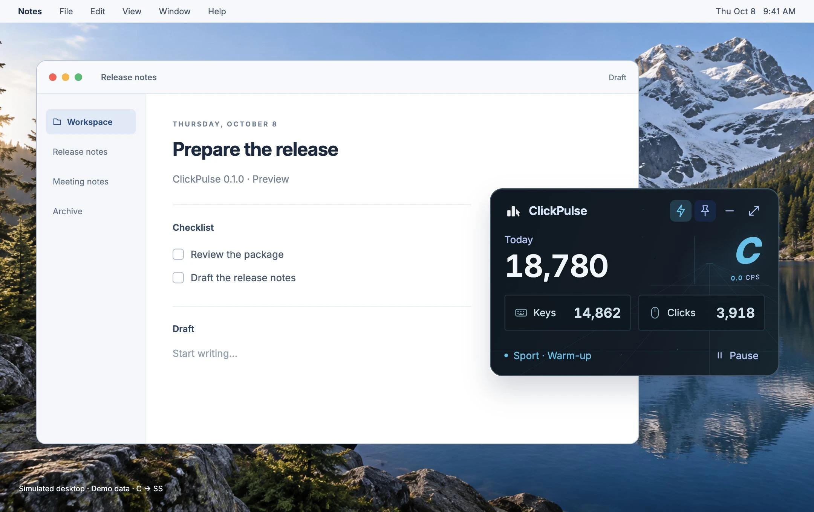

<h1 align="center">ClickPulse</h1>

<strong>Small app. Every click. Big insights.</strong>

    

An offline keyboard and mouse activity tracker for macOS and Windows. See your daily patterns, most-used keys and live counts.

## Mini mode

Simulated desktop · Demo data.

## Installation

**0.2.0** — [Download packages](https://github.com/endNone/ClickPulse/releases/tag/v0.2.0). You can also [build from source](docs/development.md).

| System | Package | Guide |
| --- | --- | --- |
| macOS 12+ · Apple Silicon | **arm64** DMG or App ZIP | [macOS installation](docs/install-macos.md) |
| macOS 12+ · Intel | **x64** DMG or App ZIP | [macOS installation](docs/install-macos.md) |
| Windows 10/11 · x64 | Portable ZIP | [Windows installation](docs/install-windows.md) |

**macOS:** move the App to Applications, allow the [first launch](docs/install-macos.md#2-allow-the-first-launch), then enable Input Monitoring. **Windows:** extract the ZIP and open ClickPulse.exe. Check **Recording** before use.

Mac packages are ad-hoc signed without notarization; Windows packages are unsigned.

**Windows launch blocked?** See [Windows security prompts](docs/install-windows.md#windows-security-prompts), including Smart App Control error 4551.

## Features

- **Overview:** 24-hour activity, 14/30/90-day trends and an activity calendar.
- **Keyboard:** physical-key heatmap and usage treemap.
- **History:** complete daily records and yearly filters.
- **Mini:** floating counts, pin/pause controls and optional Sport effects.
- **Data:** custom save folders and SQLite history imports with backups.

Four themes, eight languages and a time-zone override are available in Settings. Language and time zone follow your system by default. [Usage guide](docs/usage.md).

## Sport mode

Type and click your way from **C → B → A → S → SS**. Mini’s Warp effect adds light gates and particles as your speed rises. Red **SS** keeps the motion without shaking the window.

Simulated desktop · Demo data. [Static SS preview](docs/images/sport-desktop-ss-en.jpg).

**Off by default.** Show Sport in **Settings → Personalization**, then enable it with Mini’s lightning button. Ranks combine keyboard and mouse input. [How it works](docs/usage.md#sport-in-mini-mode).

## Screenshots

Demo data, English interface, default deep blue theme. Click an image to view the original.

### Keyboard heatmap

### Usage treemap

### History

## Privacy

No account, telemetry or cloud sync. Only key/button identities, counts and timestamps are stored locally—never typed text, pointer positions or screen contents. History is retained when you update or uninstall. [Data and privacy](docs/data-and-privacy.md).

## Documentation

Read the [documentation](docs/README.md) for installation, everyday use, backups and development.

## Contributing

Bug reports and focused pull requests are welcome. See the [contribution guide](CONTRIBUTING.md).

## License

Licensed under [GPL-3.0-or-later](LICENSE).

Bundled fonts and artwork retain their own licenses. See the [font notices](assets/fonts/README.txt) and [artwork notices](assets/badges/README.md).

## Community

Questions, ideas or something to share? Join [GitHub Discussions](https://github.com/endNone/ClickPulse/discussions). For reproducible bugs, [open an issue](https://github.com/endNone/ClickPulse/issues/new/choose).
