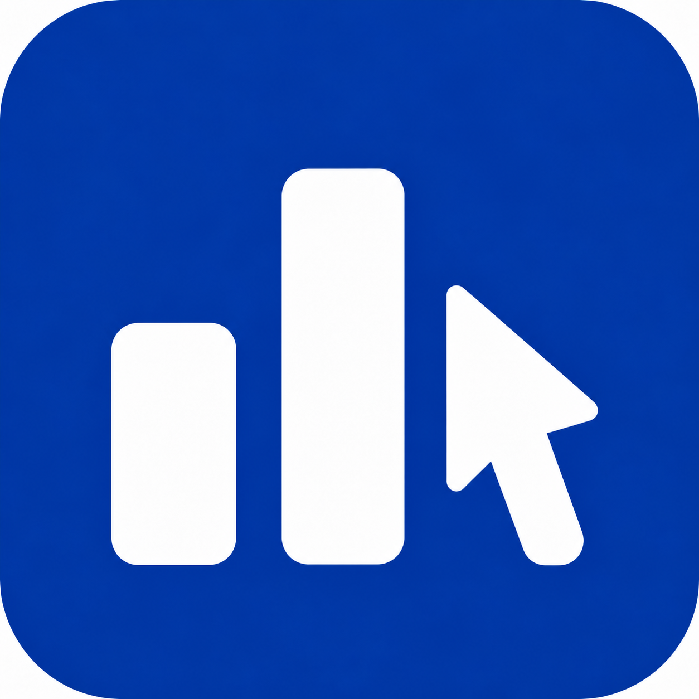
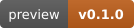
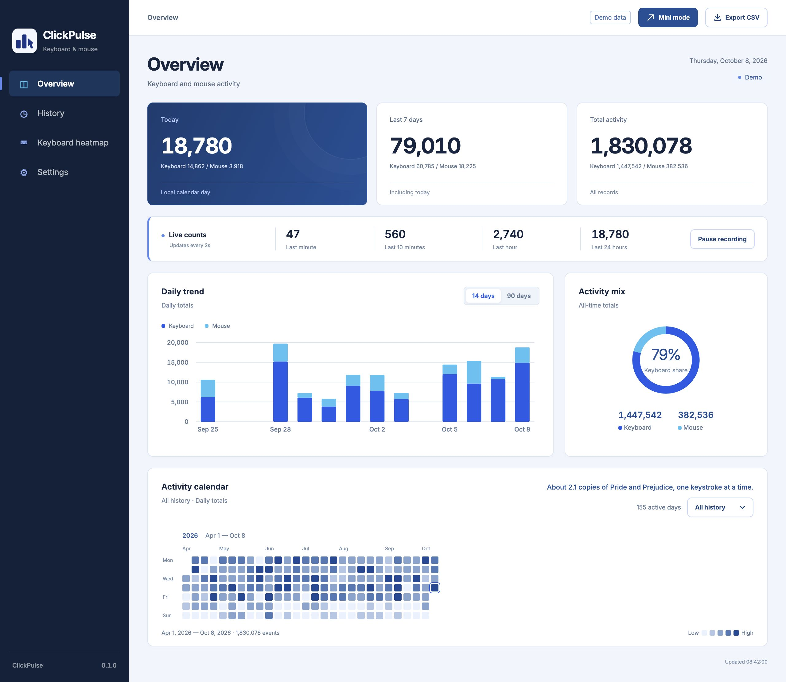
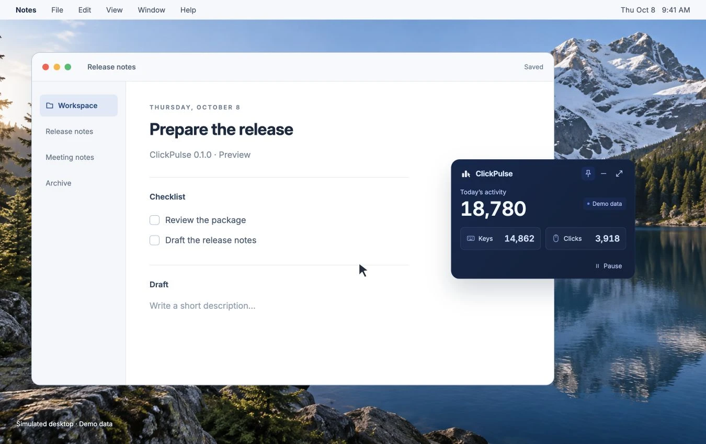
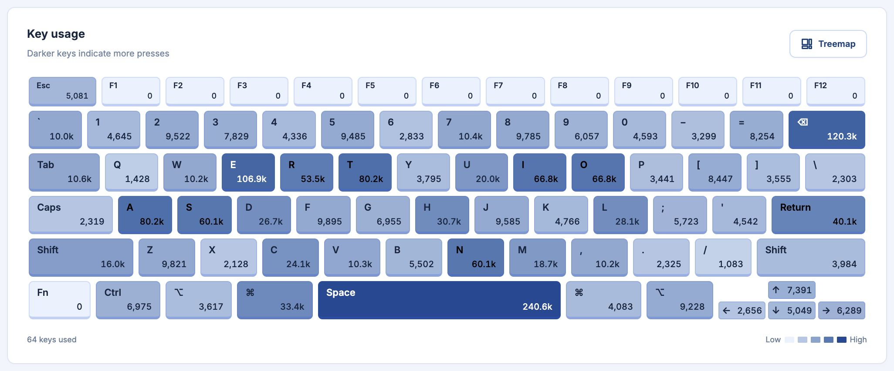
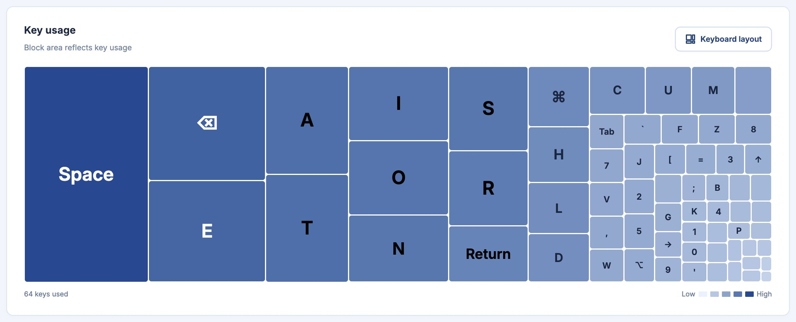
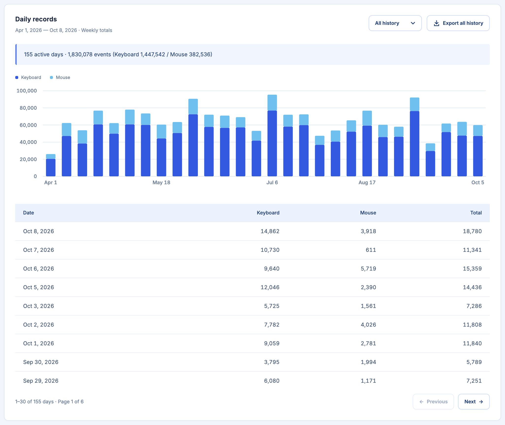

<h1 align="center">ClickPulse</h1>

<strong>Small app. Every click. Big insights.</strong>

    

ClickPulse is an offline keyboard and mouse activity tracker for macOS and Windows. Explore daily trends, see your most-used keys, and keep today’s counts in a compact floating window.

## Mini mode

Simulated desktop work with live demo counts.

## Installation

**0.1.0 Preview** — [Download packages](https://github.com/endNone/ClickPulse/releases/tag/v0.1.0). Repository access is required for this private preview. You can also [build from source](docs/development.md).

| System | Package | Guide |
| --- | --- | --- |
| macOS 12+ · Apple Silicon | **arm64** DMG or App ZIP | [macOS installation](docs/install-macos.md) |
| macOS 12+ · Intel | **x64** DMG or App ZIP | [macOS installation](docs/install-macos.md) |
| Windows 10/11 · x64 | Portable ZIP | [Windows installation](docs/install-windows.md) |

On macOS, move the complete **ClickPulse.app** to Applications, allow the [first launch](docs/install-macos.md#2-allow-the-first-launch), and enable **Input Monitoring**. On Windows, extract the complete portable ZIP and open **ClickPulse.exe**. Ready-built packages need no developer tools.

Confirm **Recording**, then press a few keys and click in another app to check that counts increase. Mac previews are ad-hoc signed without notarization; Windows previews are unsigned.

## Features

- **Activity overview:** daily trends, seven-day and all-time totals, and an activity calendar.
- **Keyboard views:** physical-key heatmap and a treemap sized by usage.
- **History:** year filtering and CSV export of daily totals.
- **Mini mode:** floating counts with pin, pause and expand controls; optional launch at login.

Four themes and English/Simplified Chinese interface options are available in Settings. Closing a window can keep recording; use **Quit ClickPulse** from the menu bar or tray to stop. See [Usage](docs/usage.md).

## Screenshots

Demo data, English interface, default deep blue theme. Click an image to view the original.

### Keyboard heatmap

### Usage treemap

### History

## Privacy

Statistics stay on your device, with no account, telemetry or cloud sync. ClickPulse records key/button identities, counts and timestamps; it does not record typed text, pointer positions or screen contents.

History is kept permanently. Updating or uninstalling the program retains your data. CSV contains daily totals, so use a database backup to preserve complete history. See [Data and privacy](docs/data-and-privacy.md).

## Documentation

Read the [documentation](docs/README.md) for installation, everyday use, backups and development.

## Contributing

Bug reports and focused pull requests are welcome. See the [contribution guide](CONTRIBUTING.md).

## License

Licensed under [GPL-3.0-or-later](LICENSE).

Bundled fonts and artwork retain their own licenses. See the [font notices](assets/fonts/README.txt) and [artwork notices](assets/badges/README.md).
