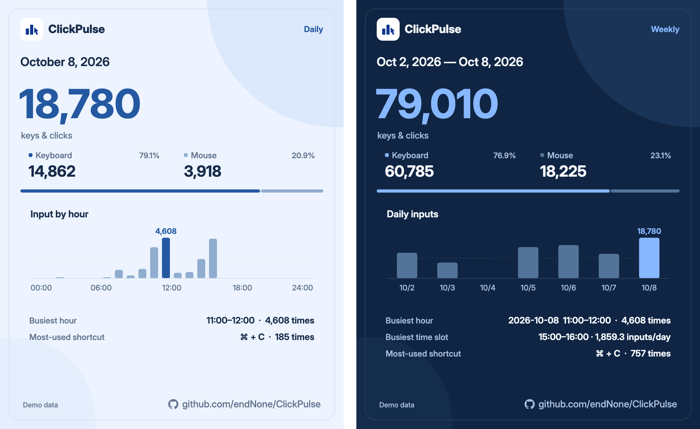
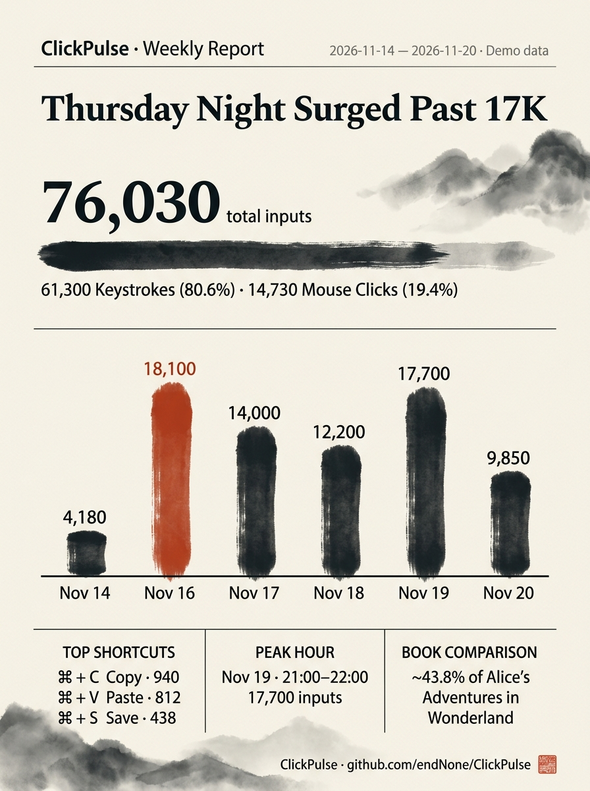
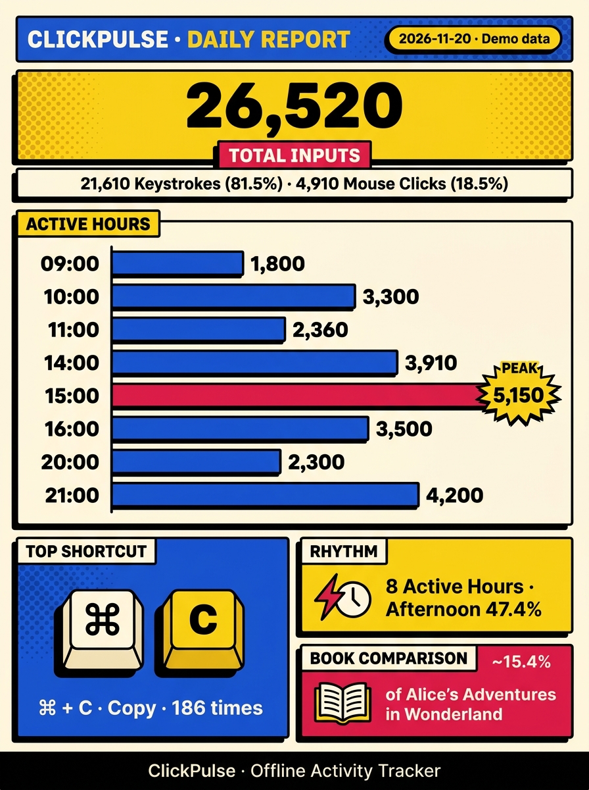
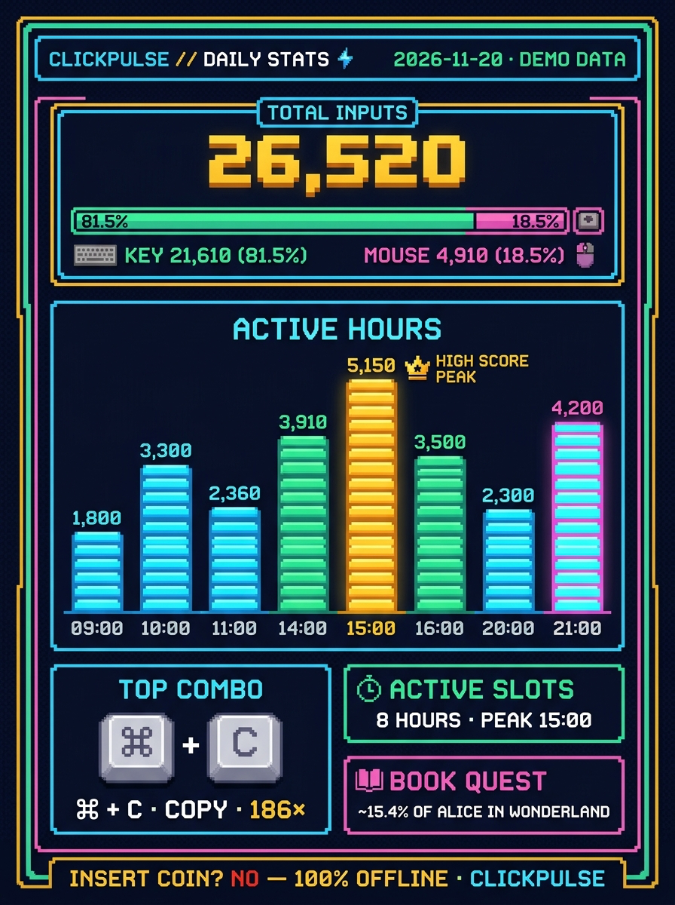
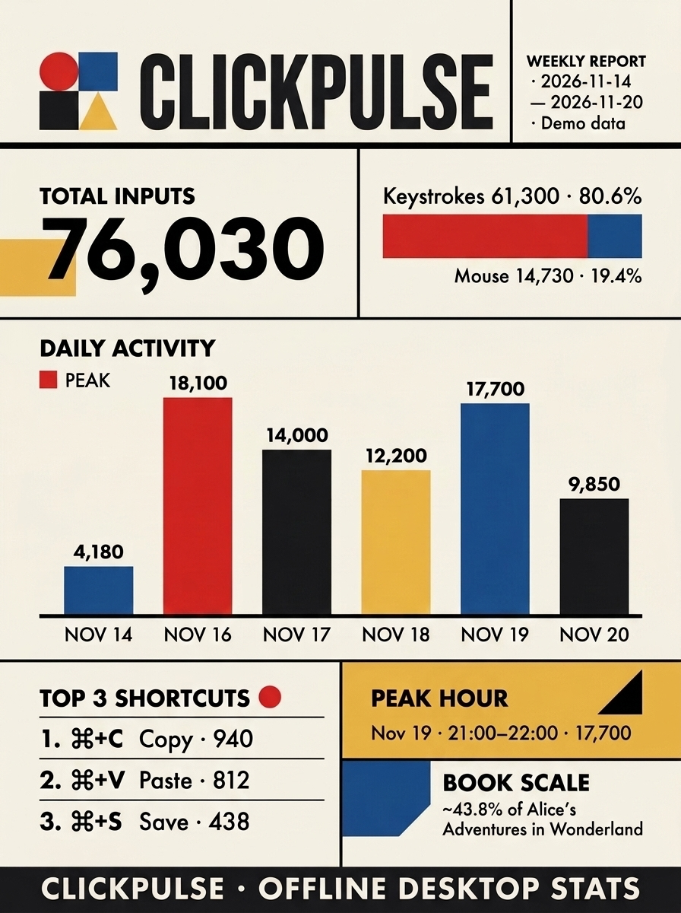
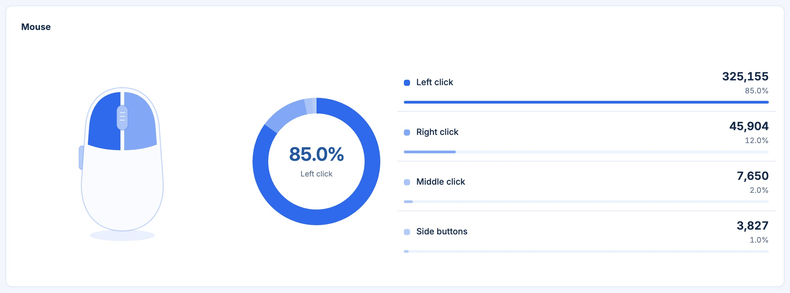
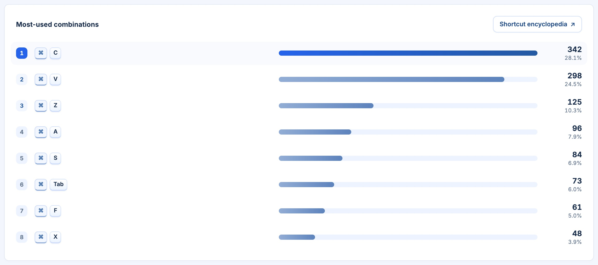

<p align="center"></p>

<h1 align="center">ClickPulse</h1>

<p align="center"><strong>English</strong> · <a href="docs/readme/zh-CN.md">简体中文</a> · <a href="docs/readme/zh-TW.md">繁體中文</a> · <a href="docs/readme/ja.md">日本語</a> · <a href="docs/readme/ko.md">한국어</a> · <a href="docs/readme/de.md">Deutsch</a> · <a href="docs/readme/es.md">Español</a> · <a href="docs/readme/fr.md">Français</a></p>

<p align="center"><strong>Small app. Every click. Big insights. Fully offline.</strong></p>

<p align="center">ClickPulse is an offline desktop app that turns your keyboard and mouse activity into daily statistics, history and heatmaps.</p>

<p align="center">
  <a href="https://github.com/endNone/ClickPulse/releases/tag/v0.3.2"></a>
  <a href="docs/development.md"></a>
  <a href="LICENSE"></a>
  <br>
  <a href="docs/install-macos.md"></a>
  <a href="docs/install-windows.md"></a>
  <a href="docs/install-linux.md"></a>
</p>

<p align="center"><a href="https://github.com/endNone/ClickPulse/releases/tag/v0.3.2">v0.3.2</a> · <a href="docs/development.md">Build from source</a> · <a href="https://endnone.github.io/ClickPulse/">Shortcut encyclopedia</a></p>


<p align="center">Your key and click statistics stay on your device.<br>No account, no telemetry.</p>

## Mini mode

Keep live counts visible in a small floating window while you use other apps.

[](docs/images/mini-desktop-en.webp)

## Sport mode

Optional effects in Mini mode react to your typing and clicking speed. Enable them with the lightning button.

[](docs/images/sport-desktop-en.gif)

## Overview

[](docs/images/overview-en.jpg)

### Daily & weekly activity reports

<p align="center"><a href="docs/images/report-en.png"></a></p>

### AI poster examples

<p align="center">
  <a href="docs/images/poster-weekly-ink.webp"></a>
  <a href="docs/images/poster-daily-pop.webp"></a>
</p>

<p align="center">
  <a href="docs/images/poster-daily-arcade.webp"></a>
  <a href="docs/images/poster-weekly-bauhaus.webp"></a>
</p>

## Screenshots

### Keyboard heatmap

[](docs/images/keyboard-en.jpg)

### Mouse button usage

[](docs/images/mouse-en.jpg)

### Usage treemap

[](docs/images/treemap-en.jpg)

### History

[](docs/images/history-en.jpg)

### Shortcut statistics

[](docs/images/shortcuts-en.jpg)

## Install

- **macOS 12+** (Apple Silicon / Intel): [Download DMG](https://github.com/endNone/ClickPulse/releases/tag/v0.3.2)
- **Windows 10 / 11** (x64): [Download portable ZIP](https://github.com/endNone/ClickPulse/releases/tag/v0.3.2)
- **Linux** (Ubuntu 22.04 / 24.04): [Download](https://github.com/endNone/ClickPulse/releases/tag/v0.3.2)

### Install with Homebrew or Scoop

**macOS Homebrew**

```sh
brew tap endnone/clickpulse https://github.com/endNone/ClickPulse
brew install --cask endnone/clickpulse/clickpulse
```

**Windows Scoop**

```powershell
scoop bucket add clickpulse https://github.com/endNone/ClickPulse
scoop install clickpulse
```

The macOS app is not notarized by Apple and the Windows app is unsigned. Your system may block the first launch. [macOS steps](docs/install-macos.md) · [Windows steps](docs/install-windows.md) · [Ubuntu steps](docs/install-linux.md)

## Download size and memory

The v0.3.1 desktop downloads are all under 7.3 MB. Starting ClickPulse in the background uses **88.5–98.9% less memory** than in v0.3.0 on the three systems tested.

**Download size (MB)**

| Platform | x64 | ARM64 |
| :--- | ---: | ---: |
| macOS 12+ | 7.27 DMG · 6.56 ZIP | 6.99 DMG · 6.31 ZIP |
| Windows 10/11 | 4.62 ZIP | — |
| Ubuntu 22.04 / 24.04 | 6.53 ZIP | 6.44 ZIP |

**Measured memory (MB)**

| Test system | Background start | Full window | Mini | Hidden for 10 min |
| :--- | ---: | ---: | ---: | ---: |
| macOS · Apple Silicon | **16.5** | 234.1 | 165.7 | 31.1 |
| Windows 11 · x64 | **2.4** | 225.0 | 181.4 | 3.7 |
| Ubuntu 24.04 · x64 | **44.5** | 261.8 | 266.6 | 109.3 |

Median of five samples for the app and its interface processes, with input recording off and the full window in English. macOS reports physical footprint, Windows reports USS, and Ubuntu reports PSS with software rendering. [v0.3.1 downloads and benchmark results](https://github.com/endNone/ClickPulse/releases/tag/v0.3.1).

## License

Code: [GPL-3.0-or-later](LICENSE). The ClickPulse name and icons are excluded from that license grant; [additional terms](TRADEMARKS.md) apply under GPLv3 sections 7(c) and 7(e). Earlier releases retain their original terms.

## More

Read the [documentation](docs/README.md) and [changelog](CHANGELOG.md).<br>
[Report a bug](https://github.com/endNone/ClickPulse/issues/new/choose) or [join the discussion](https://github.com/endNone/ClickPulse/discussions).

## Star history

If ClickPulse has been useful to you, give it a star on GitHub 🌟

<p align="center"><a href="https://www.star-history.com/#endNone/ClickPulse&amp;Date"></a></p>

## Acknowledgments

Thank you to the [Appinn community (小众软件)](https://meta.appinn.net/t/topic/95871/16) for trying ClickPulse and sharing your feedback.
