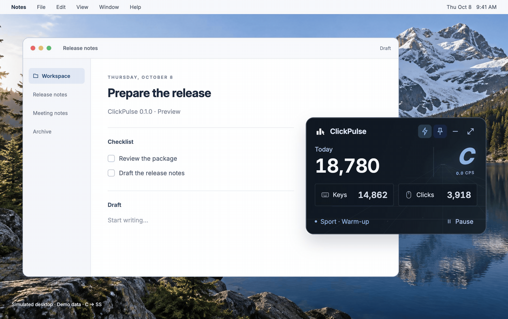

<p align="center"></p>

<h1 align="center">ClickPulse</h1>

<p align="center"><strong>Small app. Every click. Big insights. Fully offline.</strong></p>

<p align="center">ClickPulse is an offline desktop app that turns your keyboard and mouse activity into daily statistics, history and heatmaps.</p>

<p align="center">
  <a href="#install"></a>
  <a href="docs/development.md"></a>
  <a href="LICENSE"></a>
  <br>
  <a href="docs/install-macos.md"></a>
  <a href="docs/install-windows.md"></a>
  <a href="#install"></a>
</p>

<p align="center"><a href="https://github.com/endNone/ClickPulse/releases/latest">Download packages</a>. You can also <a href="docs/development.md">build from source</a>.</p>


<p align="center">Your key and click statistics stay on your device.<br>No account, no telemetry.</p>

## Overview

[](docs/images/overview-en.jpg)

## Features

- **Discover daily patterns** with activity trends and a calendar.
- **Find your most-used keys** with a heatmap and treemap.
- **Revisit any day's activity** in your complete history.
- **Move your data anywhere**, or merge history from another computer.
- **Make it yours** with four themes, eight languages and your preferred time zone.

## Install

- **macOS 12+** (Apple Silicon / Intel): [Download DMG](https://github.com/endNone/ClickPulse/releases/latest)
- **Windows 10 / 11** (x64): [Download portable ZIP](https://github.com/endNone/ClickPulse/releases/latest)
- **Linux** (Ubuntu 22.04 / 24.04): [Download](https://github.com/endNone/ClickPulse/releases/latest)

### Install with Homebrew or Scoop

**macOS Homebrew**

```sh
brew tap endnone/clickpulse https://github.com/endNone/ClickPulse
brew install --cask endnone/clickpulse/clickpulse
```

**Windows Scoop**

```powershell
scoop bucket add clickpulse https://github.com/endNone/ClickPulse
scoop install clickpulse
```

The macOS and Windows apps aren't signed yet; your system may block their first launch. [macOS steps](docs/install-macos.md) · [Windows steps](docs/install-windows.md)

## Screenshots

All screenshots use demo data.

### Mini mode

Keep live counts visible in a small floating window while you use other apps.

[](docs/images/mini-desktop-en.webp)

### Sport mode

Optional effects in Mini mode react to your typing and clicking speed. Enable them with the lightning button.

[](docs/images/sport-desktop-en.gif)

### Keyboard heatmap

[](docs/images/keyboard-en.jpg)

### Usage treemap

[](docs/images/treemap-en.jpg)

### History

[](docs/images/history-en.jpg)

## More

Read the [documentation](docs/README.md) and [changelog](CHANGELOG.md).<br>
[Report a bug](https://github.com/endNone/ClickPulse/issues/new/choose) or [join the discussion](https://github.com/endNone/ClickPulse/discussions).

## Star history

<p align="center"><a href="https://www.star-history.com/#endNone/ClickPulse&amp;Date"></a></p>
