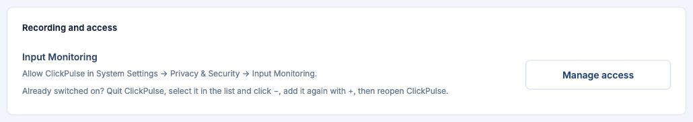

# Install on macOS

## 1. Download

[Download the DMG](https://github.com/endNone/ClickPulse/releases/latest) for macOS 12 or later, or use [Homebrew](package-managers.md#macos-homebrew-cask).

Apple chip (M1 or later) → arm64; Intel → x64.

1. Open the DMG and drag **ClickPulse** into **Applications**.
2. Open ClickPulse from Applications.

## 2. First launch

ClickPulse isn't signed by a verified publisher yet. If macOS blocks it:

1. Open **System Settings → Privacy & Security**.
2. Select **Open Anyway** beside ClickPulse, authenticate, then select **Open**.

Screenshot: Apple.

## 3. Allow input monitoring

1. Start recording: **ClickPulse → Settings → Recording and access → Manage access**.
2. Enable **ClickPulse** in **Input Monitoring**, then quit and reopen it.
3. Check that **Recording** appears and counts increase as you type and click.

## Common questions

Using macOS 12?

For first launch, use **System Preferences → Security & Privacy → General → Open Anyway**.

For recording, open **Privacy → Input Monitoring**, unlock the pane, and enable ClickPulse.

“Is damaged” or “will damage your computer”?

Download the app again. If the alert persists, [report the problem](https://github.com/endNone/ClickPulse/issues/new/choose). See [Apple's explanation](https://support.apple.com/en-us/102445).

**Not recording after an update?** Quit ClickPulse. In Input Monitoring, remove its entry with **−**, add the updated app with **+**, enable it, then reopen.

**How do I update?** Open **Settings → Application → Check for updates**, then **Update & restart**. Daily checks can be turned off. Version 0.2.0 or earlier needs one manual update.

**Where is my history?** In `~/Library/Application Support/ClickPulse`, unless you selected another folder. Updating or removing the app keeps it.
