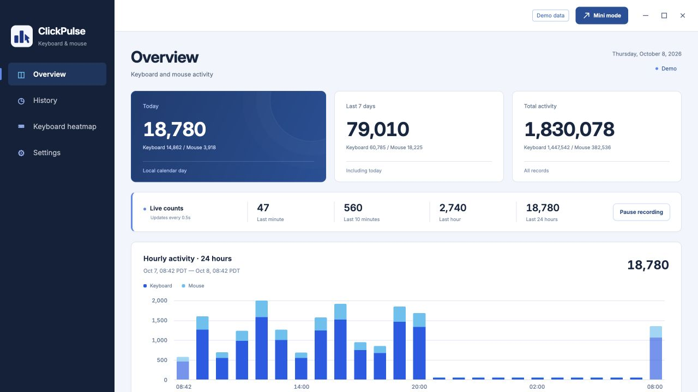
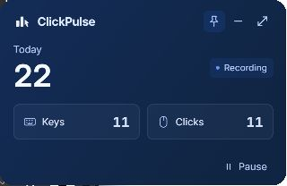

# Install on Windows

## 1. Download

[Download the portable ZIP](https://github.com/endNone/ClickPulse/releases/latest) for Windows 10/11 x64, or use [Scoop](package-managers.md#windows-scoop-bucket).

1. Extract the entire folder to a permanent location, such as `%LOCALAPPDATA%\Programs\ClickPulse`.
2. Open **ClickPulse.exe** from the extracted folder.

## 2. First launch

ClickPulse isn't signed yet. If **Microsoft Defender SmartScreen** appears, select **More info → Run anyway**, when offered. For other blocks, see [security help below](#windows-security-prompts).

## 3. Recording access

Windows needs no additional keyboard or mouse permission. Check that **Recording** appears, then type and click to see the counts increase.

## Common questions

**Missing WebView2?** Install [Microsoft Edge WebView2 Runtime](https://developer.microsoft.com/microsoft-edge/webview2/#download-section), then reopen ClickPulse.

Smart App Control or error 4551?

Smart App Control can block ClickPulse and has no individual-app exception. On a managed PC, ask your administrator. See [Microsoft's guidance](https://support.microsoft.com/en-us/windows/security/threat-malware-protection/smart-app-control-frequently-asked-questions).

**How do I update?** Open **Settings → Application → Check for updates**, then **Update & restart**. Daily checks can be turned off. Version 0.2.0 or earlier needs one manual update.

**Installed with Scoop?** Quit ClickPulse, then run `scoop update clickpulse`. See [package-manager updates](package-managers.md#windows-scoop-bucket).

**Where is my history?** In `%LOCALAPPDATA%\ClickPulse`, unless you selected another folder. Updating or removing the program keeps it.

**Why did closing the window keep it running?** Choose **Quit ClickPulse** from the tray menu to stop recording.
