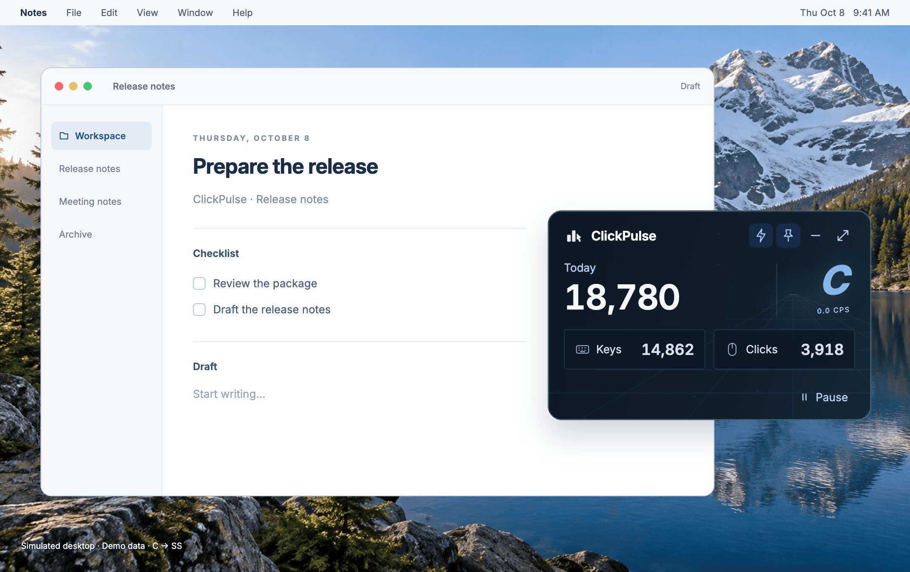
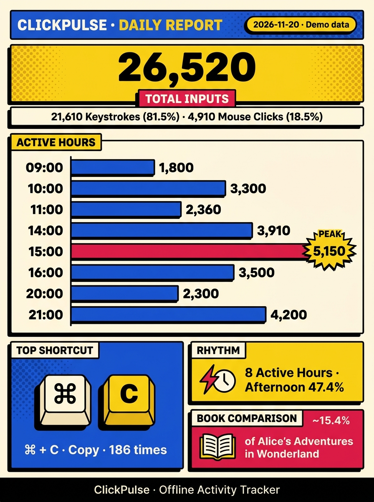

<p align="center"></p>

<h1 align="center">ClickPulse</h1>

<p align="center"><a href="../../README.md">English</a> · <a href="zh-CN.md">简体中文</a> · <a href="zh-TW.md">繁體中文</a> · <a href="ja.md">日本語</a> · <a href="ko.md">한국어</a> · <strong>Deutsch</strong> · <a href="es.md">Español</a> · <a href="fr.md">Français</a></p>

<p align="center"><strong>Tastenanschläge und Mausklicks im Blick. Ganz offline.</strong></p>

<p align="center">ClickPulse ist eine Desktop-App, die deine Tastatur- und Mausaktivität offline als Tagesstatistik, Verlauf und Heatmap darstellt.</p>

<p align="center">
  <a href="https://github.com/endNone/ClickPulse/releases/tag/v0.3.2"></a>
  <a href="../development.md"></a>
  <a href="../../LICENSE"></a>
  <br>
  <a href="../install-macos.md"></a>
  <a href="../install-windows.md"></a>
  <a href="../install-linux.md"></a>
</p>

<p align="center"><a href="https://github.com/endNone/ClickPulse/releases/tag/v0.3.2">v0.3.2</a> · <a href="../development.md">Aus dem Quellcode bauen</a> · <a href="https://endnone.github.io/ClickPulse/">Tastenkürzel-Lexikon</a></p>

<p align="center">Deine Tastatur- und Mausstatistiken bleiben auf deinem Gerät. Kein Konto, keine Telemetrie.</p>

## Mini-Modus

Ein kleines schwebendes Fenster zeigt dir die aktuellen Zählerstände, während du in anderen Apps arbeitest.

[](../images/mini-desktop-en.webp)

## Sport-Modus

Über die Blitz-Schaltfläche im Mini-Fenster aktivierst du Animationen, die auf dein Tipp- und Klicktempo reagieren.

[](../images/sport-desktop-en.gif)

## Überblick

[](../images/overview-en.jpg)

### Tages- und Wochenberichte

<p align="center"><a href="../images/report-en.png"></a></p>

### Beispiele für KI-generierte Poster

<p align="center">
  <a href="../images/poster-weekly-ink.webp"></a>
  <a href="../images/poster-daily-pop.webp"></a>
</p>

<p align="center">
  <a href="../images/poster-daily-arcade.webp"></a>
  <a href="../images/poster-weekly-bauhaus.webp"></a>
</p>

## Screenshots

### Tastatur-Heatmap

[](../images/keyboard-en.jpg)

### Klicks nach Maustaste

[](../images/mouse-en.jpg)

### Tastennutzung als Treemap

[](../images/treemap-en.jpg)

### Verlauf

[](../images/history-en.jpg)

### Tastenkürzel-Statistik

[](../images/shortcuts-en.jpg)

## Installation

- **macOS 12+** (Apple Silicon / Intel) · [DMG herunterladen](https://github.com/endNone/ClickPulse/releases/tag/v0.3.2)
- **Windows 10 / 11** (x64) · [Portable ZIP-Datei herunterladen](https://github.com/endNone/ClickPulse/releases/tag/v0.3.2)
- **Linux** (Ubuntu 22.04 / 24.04) · [Linux-Paket herunterladen](https://github.com/endNone/ClickPulse/releases/tag/v0.3.2)

### Installation mit Homebrew oder Scoop

**macOS · Homebrew**

```sh
brew tap endnone/clickpulse https://github.com/endNone/ClickPulse
brew install --cask endnone/clickpulse/clickpulse
```

**Windows · Scoop**

```powershell
scoop bucket add clickpulse https://github.com/endNone/ClickPulse
scoop install clickpulse
```

Die macOS-App ist nicht von Apple notarisiert, die Windows-App ist unsigniert. Das Betriebssystem kann den ersten Start blockieren.

Installationsanleitungen · [macOS](../install-macos.md) · [Windows](../install-windows.md) · [Ubuntu](../install-linux.md)

## Downloadgröße und Speicherbedarf

Alle Desktop-Pakete von v0.3.1 sind kleiner als 7,3 MB. Beim Start im Hintergrund war der Speicherbedarf auf den drei getesteten Systemen **88,5–98,9 % niedriger** als mit v0.3.0.

**Downloadgröße (MB)**

| Plattform | x64 | ARM64 |
| :--- | ---: | ---: |
| macOS 12+ | 7,27 DMG · 6,56 ZIP | 6,99 DMG · 6,31 ZIP |
| Windows 10/11 | 4,62 ZIP | — |
| Ubuntu 22.04 / 24.04 | 6,53 ZIP | 6,44 ZIP |

**Gemessener Speicherbedarf (MB)**

| Testsystem | Hintergrundstart | Hauptfenster | Mini-Modus | 10 Min. ausgeblendet |
| :--- | ---: | ---: | ---: | ---: |
| macOS · Apple Silicon | **16,5** | 234,1 | 165,7 | 31,1 |
| Windows 11 · x64 | **2,4** | 225,0 | 181,4 | 3,7 |
| Ubuntu 24.04 · x64 | **44,5** | 261,8 | 266,6 | 109,3 |

Median aus fünf Messungen für die App und ihre Oberflächenprozesse bei ausgeschalteter Eingabeaufzeichnung. Das Hauptfenster wurde auf Englisch angezeigt. Messgrößen waren der Physical Footprint unter macOS, USS unter Windows und PSS unter Ubuntu mit Software-Rendering. [Downloads und Messergebnisse für v0.3.1](https://github.com/endNone/ClickPulse/releases/tag/v0.3.1).

## Lizenz

Der Code steht unter der [GPL-3.0-or-later](../../LICENSE). Der Name ClickPulse und die Symbole sind von dieser Lizenz ausgenommen. Für sie gelten [zusätzliche Bedingungen](../../TRADEMARKS.md) gemäß Abschnitt 7(c) und 7(e) der GPLv3. Für frühere Versionen gelten die bei ihrer Veröffentlichung gültigen Bedingungen.

## Weitere Informationen

[Dokumentation](../README.md) · [Änderungsprotokoll](../../CHANGELOG.md)<br>
[Fehler melden](https://github.com/endNone/ClickPulse/issues/new/choose) · [Mitdiskutieren](https://github.com/endNone/ClickPulse/discussions)

## GitHub-Sterne im Zeitverlauf

Wenn dir ClickPulse hilft, freuen wir uns über einen Stern auf GitHub 🌟

<p align="center"><a href="https://www.star-history.com/#endNone/ClickPulse&amp;Date"></a></p>

## Danksagung

Danke an die [Appinn-Community (小众软件)](https://meta.appinn.net/t/topic/95871/16) fürs Ausprobieren von ClickPulse und für eure Rückmeldungen und Ideen.
