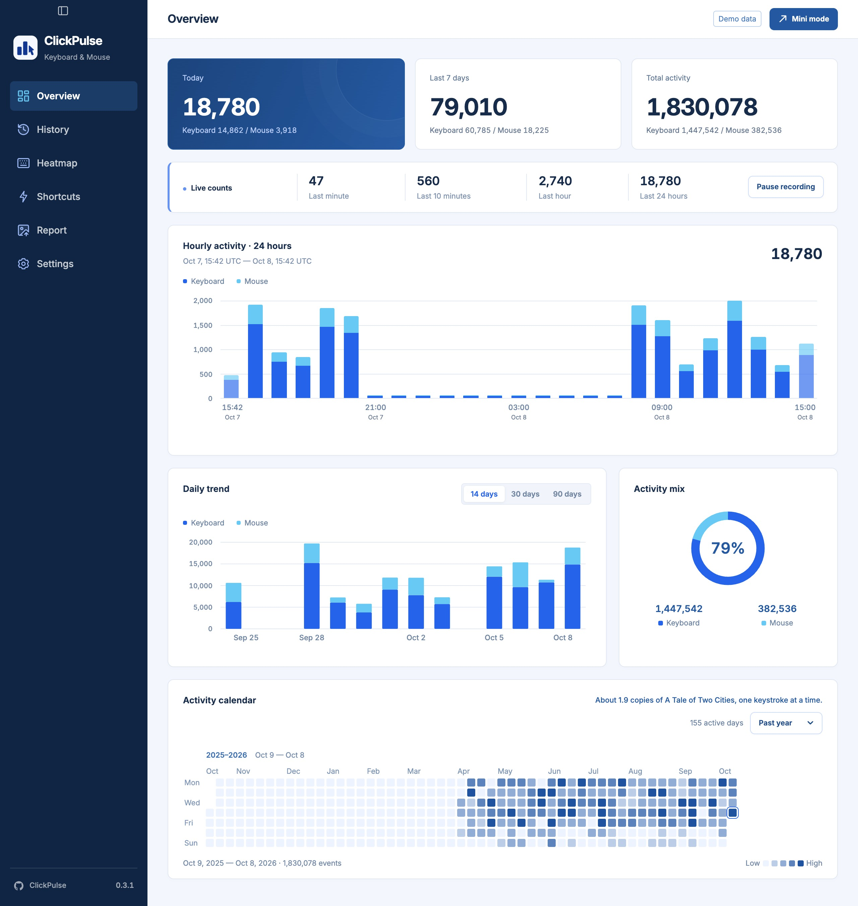
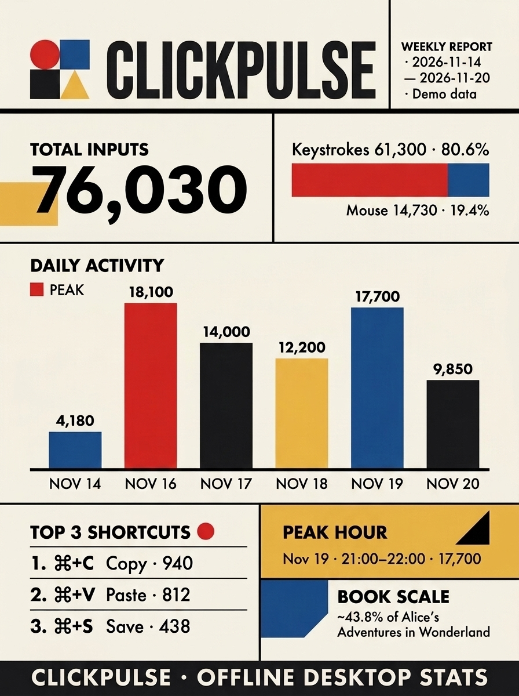

<p align="center"></p>

<h1 align="center">ClickPulse</h1>

<p align="center"><a href="../../README.md">English</a> · <a href="zh-CN.md">简体中文</a> · <a href="zh-TW.md">繁體中文</a> · <strong>日本語</strong> · <a href="ko.md">한국어</a> · <a href="de.md">Deutsch</a> · <a href="es.md">Español</a> · <a href="fr.md">Français</a></p>

<p align="center"><strong>日々のキー入力とクリックを、手元で振り返る。</strong></p>

<p align="center">ClickPulse は、キーボードとマウスの使用状況を日ごとの統計、履歴、ヒートマップで表示するオフラインのデスクトップアプリです。</p>

<p align="center">
  <a href="https://github.com/endNone/ClickPulse/releases/tag/v0.3.2"></a>
  <a href="../development.md"></a>
  <a href="../../LICENSE"></a>
  <br>
  <a href="../install-macos.md"></a>
  <a href="../install-windows.md"></a>
  <a href="../install-linux.md"></a>
</p>

<p align="center"><strong><a href="#インストール">インストール</a></strong> · <a href="https://github.com/endNone/ClickPulse/releases/tag/v0.3.2">v0.3.2 をダウンロード</a> · <a href="../development.md">ソースからビルド</a> · <a href="https://endnone.github.io/ClickPulse/">ショートカット事典</a></p>

<p align="center">キー入力とクリックの統計は端末内に保存されます。アカウント登録は不要で、テレメトリも収集しません。</p>

## Mini モード

小さなフローティングウィンドウで、他のアプリを使いながら入力回数を確認できます。

[](../images/mini-desktop-en.webp)

## Sport モード

Mini ウィンドウの稲妻ボタンを押すと、入力やクリックの速さに反応するアニメーションが有効になります。

[](../images/sport-desktop-en.gif)

## 概要

[](../images/overview-en.jpg)

### 日次・週次アクティビティレポート

<p align="center"><a href="../images/report-en.png"></a></p>

### AI 生成ポスターの例

<p align="center">
  <a href="../images/poster-weekly-ink.webp"></a>
  <a href="../images/poster-daily-pop.webp"></a>
</p>

<p align="center">
  <a href="../images/poster-daily-arcade.webp"></a>
  <a href="../images/poster-weekly-bauhaus.webp"></a>
</p>

## スクリーンショット

### キーボードヒートマップ

[](../images/keyboard-en.jpg)

### マウスボタンの使用割合

[](../images/mouse-en.jpg)

### キー使用頻度のツリーマップ

[](../images/treemap-en.jpg)

### 履歴

[](../images/history-en.jpg)

### ショートカットの使用統計

[](../images/shortcuts-en.jpg)

## インストール

- **macOS 12+** (Apple Silicon / Intel) · [DMG をダウンロード](https://github.com/endNone/ClickPulse/releases/tag/v0.3.2)
- **Windows 10 / 11** (x64) · [ポータブル版 ZIP をダウンロード](https://github.com/endNone/ClickPulse/releases/tag/v0.3.2)
- **Linux** (Ubuntu 22.04 / 24.04) · [Linux 版をダウンロード](https://github.com/endNone/ClickPulse/releases/tag/v0.3.2)

### Homebrew または Scoop でインストール

**macOS · Homebrew**

```sh
brew tap endnone/clickpulse https://github.com/endNone/ClickPulse
brew install --cask endnone/clickpulse/clickpulse
```

**Windows · Scoop**

```powershell
scoop bucket add clickpulse https://github.com/endNone/ClickPulse
scoop install clickpulse
```

macOS 版は Apple の公証を受けておらず、Windows 版は未署名です。初回起動時に OS が実行をブロックすることがあります。

OS 別インストールガイド · [macOS](../install-macos.md) · [Windows](../install-windows.md) · [Ubuntu](../install-linux.md)

## ダウンロードサイズとメモリ使用量

v0.3.1 のデスクトップ版はどのパッケージも 7.3 MB 未満です。検証した 3 つの環境では、バックグラウンド起動時のメモリ使用量が v0.3.0 より **88.5～98.9% 減少**しました。

**ダウンロードサイズ（MB）**

| プラットフォーム | x64 | ARM64 |
| :--- | ---: | ---: |
| macOS 12+ | 7.27 DMG · 6.56 ZIP | 6.99 DMG · 6.31 ZIP |
| Windows 10/11 | 4.62 ZIP | — |
| Ubuntu 22.04 / 24.04 | 6.53 ZIP | 6.44 ZIP |

**メモリ使用量の実測値（MB）**

| 検証環境 | バックグラウンド起動時 | 通常ウィンドウ | Mini モード | 非表示から 10 分後 |
| :--- | ---: | ---: | ---: | ---: |
| macOS · Apple Silicon | **16.5** | 234.1 | 165.7 | 31.1 |
| Windows 11 · x64 | **2.4** | 225.0 | 181.4 | 3.7 |
| Ubuntu 24.04 · x64 | **44.5** | 261.8 | 266.6 | 109.3 |

入力の記録をオフにし、アプリ本体と画面表示に使うプロセスの合計を 5 回測定した中央値です。通常ウィンドウの表示言語は英語です。macOS は physical footprint、Windows は USS、Ubuntu はソフトウェアレンダリング時の PSS を使用しています。 [v0.3.1 のダウンロードと測定結果](https://github.com/endNone/ClickPulse/releases/tag/v0.3.1).

## ライセンス

コードのライセンスは [GPL-3.0-or-later](../../LICENSE) です。ClickPulse の名称とアイコンはこの許諾の対象外で、GPLv3 の第 7(c) 項および第 7(e) 項に基づく[追加条項](../../TRADEMARKS.md)が適用されます。それ以前のリリースには公開時の条項が適用されます。

## 関連リンク

[ドキュメント](../README.md) · [変更履歴](../../CHANGELOG.md)<br>
[不具合を報告](https://github.com/endNone/ClickPulse/issues/new/choose) · [ディスカッションに参加](https://github.com/endNone/ClickPulse/discussions)

## GitHub スター数の推移

ClickPulse が役に立ったら、GitHub でスターを付けていただけるとうれしいです 🌟

<p align="center"><a href="https://www.star-history.com/#endNone/ClickPulse&amp;Date"></a></p>

## 謝辞

ClickPulse を試し、感想や改善案を寄せてくださった [Appinn（小众软件）コミュニティ](https://meta.appinn.net/t/topic/95871/16)の皆さんに感謝します。
