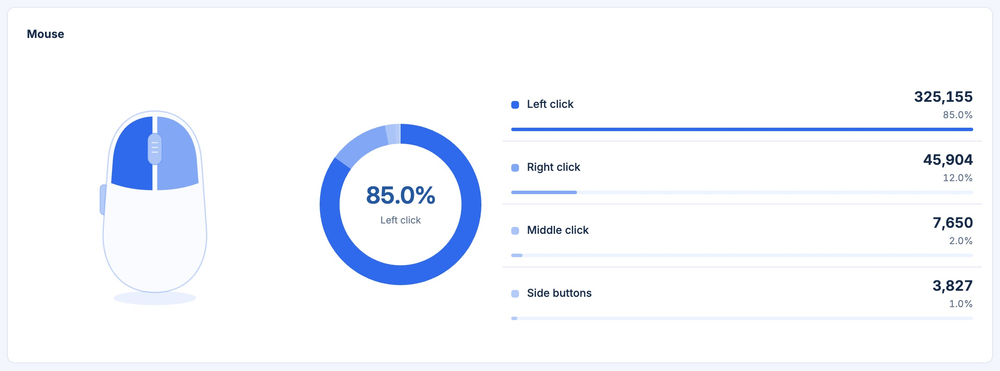
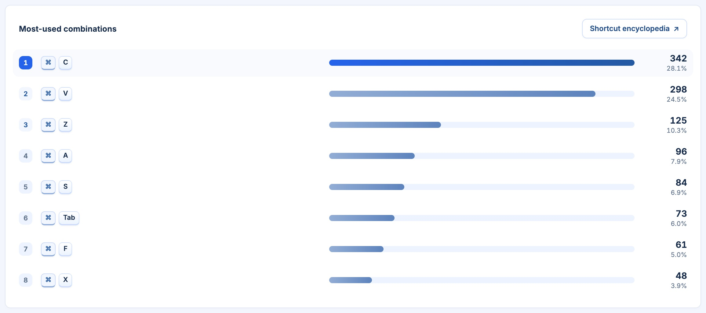
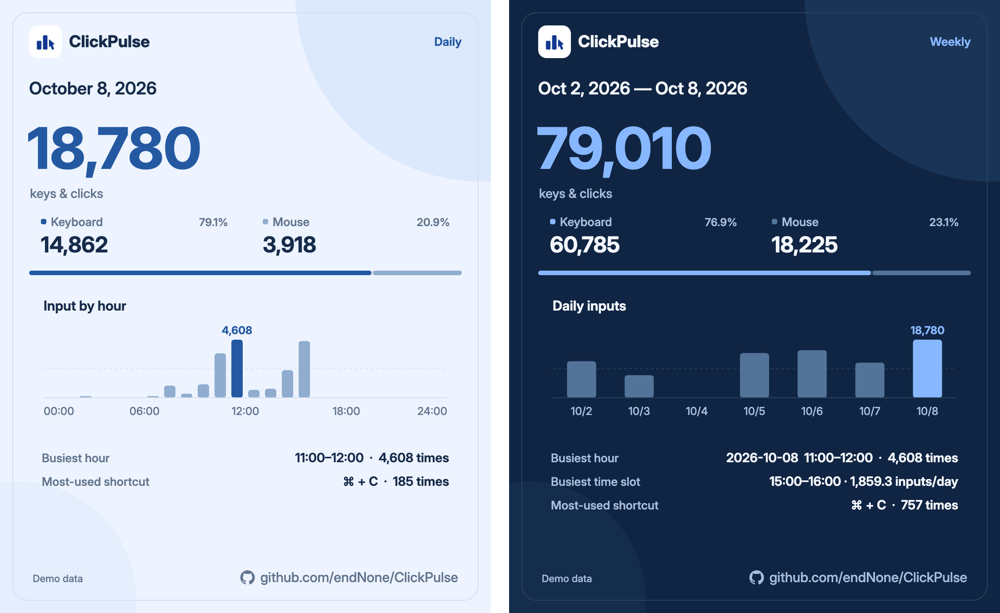
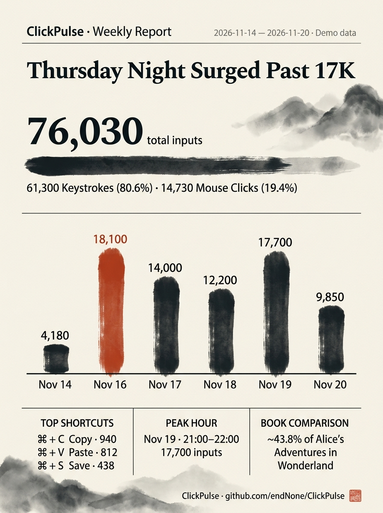
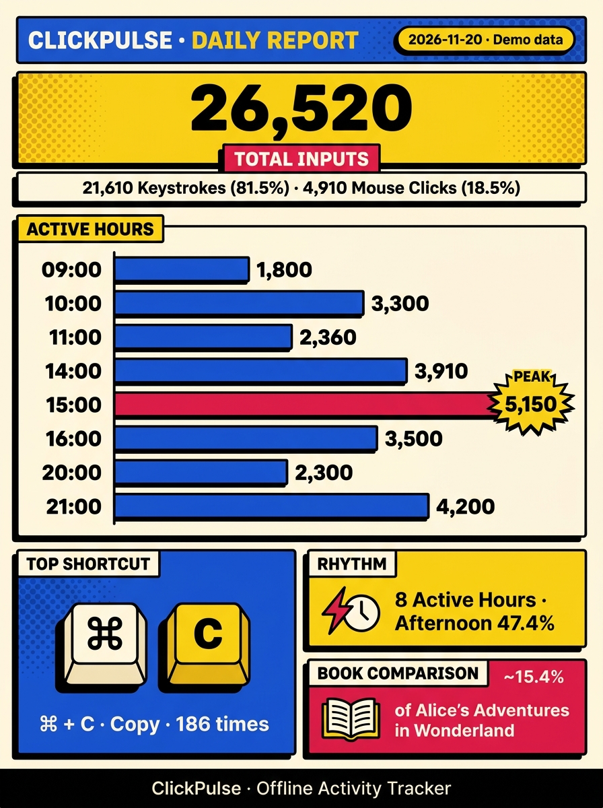
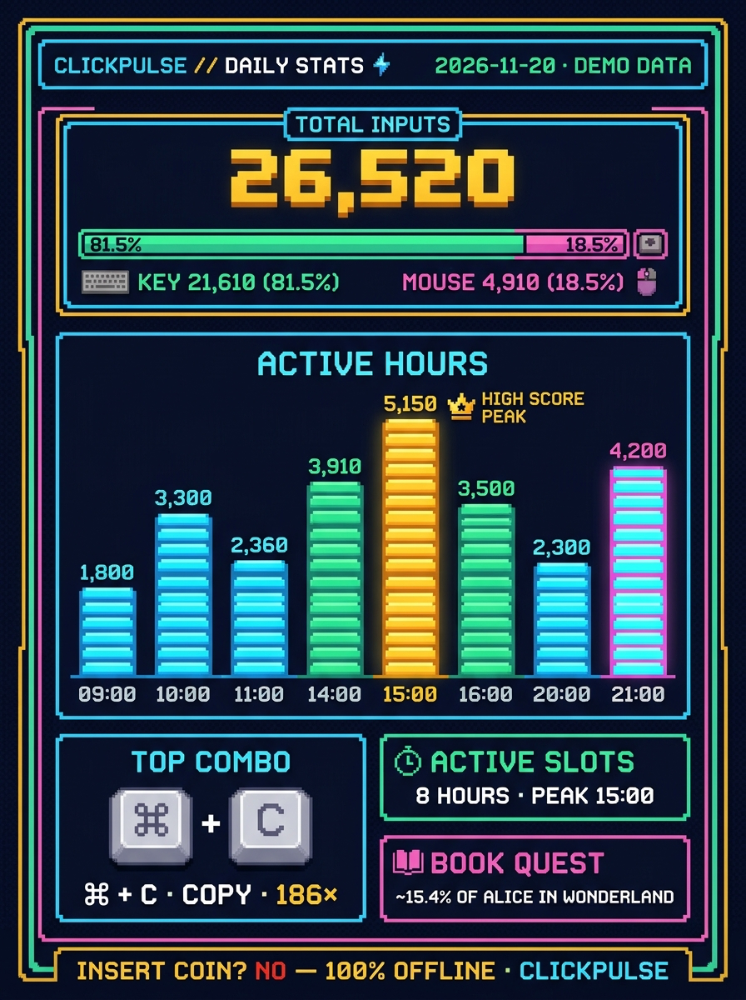
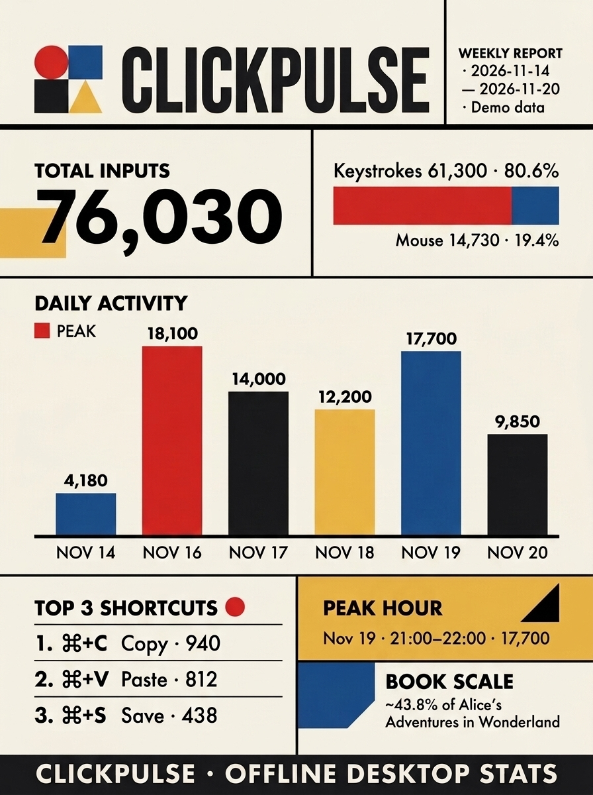

<p align="center"></p>

<h1 align="center">ClickPulse</h1>

<p align="center"><a href="../../README.md">English</a> · <a href="zh-CN.md">简体中文</a> · <a href="zh-TW.md">繁體中文</a> · <a href="ja.md">日本語</a> · <strong>한국어</strong> · <a href="de.md">Deutsch</a> · <a href="es.md">Español</a> · <a href="fr.md">Français</a></p>

<p align="center"><strong>키 입력과 클릭으로 돌아보는 나의 하루</strong></p>

<p align="center">ClickPulse는 키보드와 마우스 사용량을 일별 통계, 기록, 히트맵으로 보여 주는 오프라인 데스크톱 앱입니다.</p>

<p align="center">
  <a href="https://github.com/endNone/ClickPulse/releases/tag/v0.3.2"></a>
  <a href="../development.md"></a>
  <a href="../../LICENSE"></a>
  <br>
  <a href="../install-macos.md"></a>
  <a href="../install-windows.md"></a>
  <a href="../install-linux.md"></a>
</p>

<p align="center"><a href="https://github.com/endNone/ClickPulse/releases/tag/v0.3.2">v0.3.2</a> · <a href="../development.md">소스에서 빌드</a> · <a href="https://endnone.github.io/ClickPulse/">단축키 백과</a></p>

<p align="center">키 입력과 클릭 통계는 기기에만 저장됩니다. 계정이 필요 없으며 원격 측정 데이터를 수집하지 않습니다.</p>

<p align="center">새 버전을 확인하고 업데이트를 다운로드할 때 GitHub에 연결합니다. 설정에서 자동 확인을 끌 수 있습니다.</p>

## 기능

- 활동 추이와 달력에서 일상적인 사용 패턴을 확인하세요.
- 키보드 히트맵과 트리맵에서 자주 누르는 키를 찾아보세요.
- 기록에서 날짜를 선택해 그날의 활동을 살펴보세요.
- 데이터 저장 위치를 옮기거나 다른 컴퓨터의 기록을 합칠 수 있습니다.
- 테마 4종, 표시 언어 8종 중에서 선택하고 통계에 사용할 시간대를 지정하세요.

## 설치

- **macOS 12+** (Apple Silicon / Intel) · [DMG 다운로드](https://github.com/endNone/ClickPulse/releases/tag/v0.3.2)
- **Windows 10 / 11** (x64) · [포터블 ZIP 다운로드](https://github.com/endNone/ClickPulse/releases/tag/v0.3.2)
- **Linux** (Ubuntu 22.04 / 24.04) · [Linux 패키지 다운로드](https://github.com/endNone/ClickPulse/releases/tag/v0.3.2)

### Homebrew 또는 Scoop으로 설치

**macOS · Homebrew**

```sh
brew tap endnone/clickpulse https://github.com/endNone/ClickPulse
brew install --cask endnone/clickpulse/clickpulse
```

**Windows · Scoop**

```powershell
scoop bucket add clickpulse https://github.com/endNone/ClickPulse
scoop install clickpulse
```

macOS 버전은 Apple의 공증을 받지 않았으며 Windows 버전은 서명되지 않았습니다. 운영체제가 첫 실행을 차단할 수 있습니다.

운영체제별 설치 안내 · [macOS](../install-macos.md) · [Windows](../install-windows.md) · [Ubuntu](../install-linux.md)

## Mini 모드

다른 앱을 쓰는 동안에도 작은 플로팅 창에서 실시간 횟수를 확인할 수 있습니다.

[](../images/mini-desktop-en.webp)

## Sport 모드

Mini 창의 번개 버튼을 누르면 타이핑이나 클릭 속도에 반응하는 애니메이션이 켜집니다.

[](../images/sport-desktop-en.gif)

## 개요

[](../images/overview-en.jpg)

## 스크린샷

### 키보드 히트맵

[](../images/keyboard-en.jpg)

### 마우스 버튼별 클릭 비율

[](../images/mouse-en.jpg)

### 키 사용량 트리맵

[](../images/treemap-en.jpg)

### 기록

[](../images/history-en.jpg)

### 단축키 사용 통계

[](../images/shortcuts-en.jpg)

### 일간 및 주간 활동 보고서

<p align="center"><a href="../images/report-en.png"></a></p>

### AI 생성 포스터 예시

<p align="center">
  <a href="../images/poster-weekly-ink.webp"></a>
  <a href="../images/poster-daily-pop.webp"></a>
</p>

<p align="center">
  <a href="../images/poster-daily-arcade.webp"></a>
  <a href="../images/poster-weekly-bauhaus.webp"></a>
</p>

## 다운로드 크기와 메모리 사용량

v0.3.1 데스크톱 패키지는 모두 7.3 MB 미만입니다. 테스트한 세 시스템에서 백그라운드로 시작할 때의 메모리 사용량이 v0.3.0보다 **88.5~98.9% 줄었습니다**.

**다운로드 크기(MB)**

| 플랫폼 | x64 | ARM64 |
| :--- | ---: | ---: |
| macOS 12+ | 7.27 DMG · 6.56 ZIP | 6.99 DMG · 6.31 ZIP |
| Windows 10/11 | 4.62 ZIP | — |
| Ubuntu 22.04 / 24.04 | 6.53 ZIP | 6.44 ZIP |

**실측 메모리 사용량(MB)**

| 테스트 환경 | 백그라운드 시작 | 전체 창 | Mini 모드 | 창을 숨긴 지 10분 후 |
| :--- | ---: | ---: | ---: | ---: |
| macOS · Apple Silicon | **16.5** | 234.1 | 165.7 | 31.1 |
| Windows 11 · x64 | **2.4** | 225.0 | 181.4 | 3.7 |
| Ubuntu 24.04 · x64 | **44.5** | 261.8 | 266.6 | 109.3 |

입력 기록을 끈 상태에서 앱과 화면 표시 프로세스의 메모리 사용량을 합산해 다섯 번 측정한 중앙값입니다. 전체 창의 표시 언어는 영어였습니다. macOS는 physical footprint, Windows는 USS, Ubuntu는 소프트웨어 렌더링 환경의 PSS를 사용했습니다. [v0.3.1 다운로드 및 전체 측정 결과](https://github.com/endNone/ClickPulse/releases/tag/v0.3.1).

## 라이선스

코드는 [GPL-3.0-or-later](../../LICENSE)로 배포합니다. ClickPulse 이름과 아이콘은 이 라이선스의 허가 범위에서 제외되며 GPLv3 제7조 (c)항과 (e)항에 따른 [추가 조건](../../TRADEMARKS.md)이 적용됩니다. 이전 릴리스에는 배포 당시의 조건이 적용됩니다.

## 관련 링크

[프로젝트 문서](../README.md) · [변경 기록](../../CHANGELOG.md)<br>
[버그 신고](https://github.com/endNone/ClickPulse/issues/new/choose) · [토론 참여](https://github.com/endNone/ClickPulse/discussions)

## GitHub 스타 수 추이

ClickPulse가 유용했다면 GitHub에서 별표를 남겨 주세요 🌟

<p align="center"><a href="https://www.star-history.com/#endNone/ClickPulse&amp;Date"></a></p>

## 감사의 말

ClickPulse를 사용해 보고 소감과 개선 의견을 나눠 주신 [Appinn(小众软件) 커뮤니티](https://meta.appinn.net/t/topic/95871/16) 여러분께 감사드립니다.
