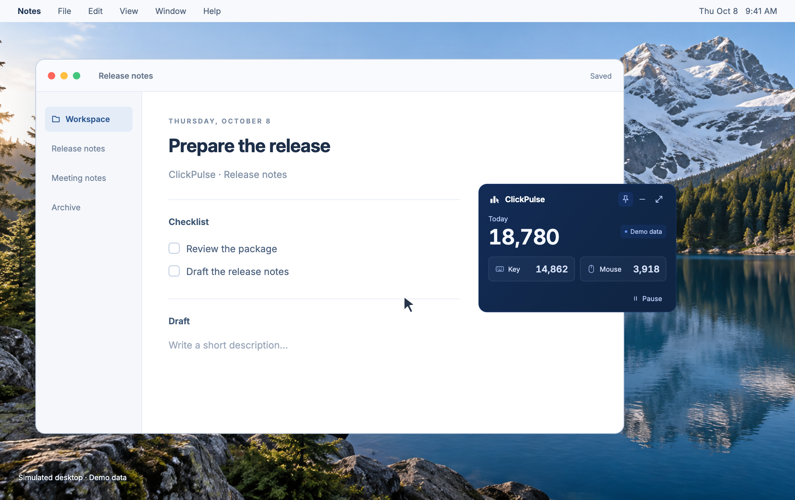
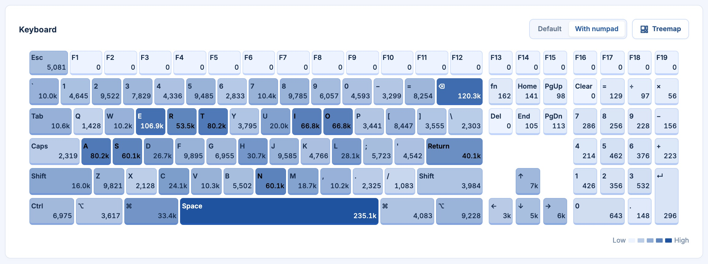
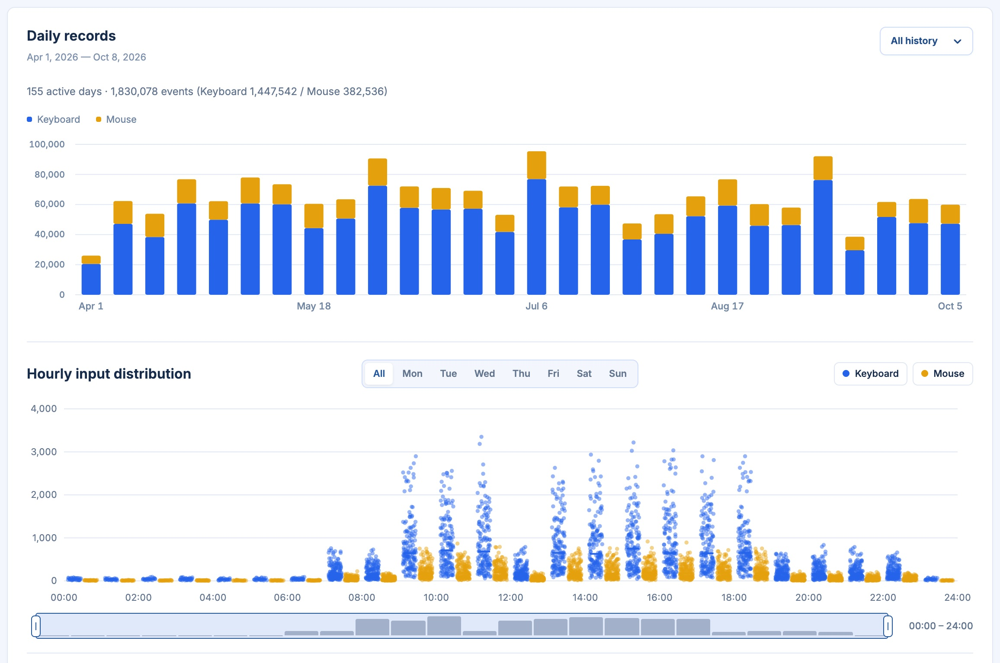

<p align="center"></p>

<h1 align="center">ClickPulse</h1>

<p align="center"><a href="../../README.md">English</a> · <strong>简体中文</strong> · <a href="zh-TW.md">繁體中文</a> · <a href="ja.md">日本語</a> · <a href="ko.md">한국어</a> · <a href="de.md">Deutsch</a> · <a href="es.md">Español</a> · <a href="fr.md">Français</a></p>

<p align="center"><strong>每一次敲击和点击，都有迹可循。</strong></p>

<p align="center">ClickPulse 是一款离线桌面应用，用每日统计、历史记录和热力图展示你的键盘和鼠标使用情况。</p>

<p align="center">
  <a href="#安装"></a>
  <a href="../development.md"></a>
  <a href="../../LICENSE"></a>
  <br>
  <a href="../install-macos.md"></a>
  <a href="../install-windows.md"></a>
  <a href="../install-linux.md"></a>
</p>

<p align="center"><a href="https://github.com/endNone/ClickPulse/releases/latest">下载安装包</a> · <a href="../development.md">从源码构建</a></p>

<p align="center">按键和点击统计只保存在你的设备上，无需账号，也不收集遥测数据。</p>

<p align="center">检查和下载更新时会连接 GitHub。你可以在设置中关闭自动检查。</p>

## 概览

[](../images/overview-en.jpg)

## 功能

- 通过活动趋势和日历，找出每天最活跃的时段。
- 在键盘热力图和矩形树图中查看最常用的按键。
- 在历史记录中回看任意一天的活动。
- 迁移数据目录，或合并另一台电脑上的历史记录。
- 从四款主题和八种界面语言中选择，并设置统计使用的时区。

## 安装

- **macOS 12+** (Apple Silicon / Intel) · [下载 DMG](https://github.com/endNone/ClickPulse/releases/latest)
- **Windows 10 / 11** (x64) · [下载便携版 ZIP](https://github.com/endNone/ClickPulse/releases/latest)
- **Linux** (Ubuntu 22.04 / 24.04) · [下载 Linux 安装包](https://github.com/endNone/ClickPulse/releases/latest)

### 使用 Homebrew 或 Scoop 安装

**macOS · Homebrew**

```sh
brew tap endnone/clickpulse https://github.com/endNone/ClickPulse
brew install --cask endnone/clickpulse/clickpulse
```

**Windows · Scoop**

```powershell
scoop bucket add clickpulse https://github.com/endNone/ClickPulse
scoop install clickpulse
```

macOS 版未经 Apple 公证，Windows 版未签名。系统可能会在首次启动时阻止运行。

分平台安装指南 · [macOS](../install-macos.md) · [Windows](../install-windows.md) · [Ubuntu](../install-linux.md)

## 截图

以下截图均使用演示数据。

### Mini 模式

使用其他应用时，也可以通过小型悬浮窗查看实时计数。

[](../images/mini-desktop-en.webp)

### Sport 模式

点击 Mini 窗口中的闪电按钮，即可开启随打字和点击速度变化的动画效果。

[](../images/sport-desktop-en.gif)

### 键盘热力图

[](../images/keyboard-en.jpg)

### 按键使用分布（矩形树图）

[](../images/treemap-en.jpg)

### 历史记录

[](../images/history-en.jpg)

## 许可证

项目代码采用 [GPL-3.0-or-later](../../LICENSE) 许可。自 v0.3.2 起，ClickPulse 名称和图标不在此许可范围内，适用 GPLv3 第 7(c) 和 7(e) 款下的[附加条款](../../TRADEMARKS.md)。此前发布的版本沿用各自发布时的条款。

## 更多

[项目文档](../README.md) · [更新日志](../../CHANGELOG.md)<br>
[报告问题](https://github.com/endNone/ClickPulse/issues/new/choose) · [参与讨论](https://github.com/endNone/ClickPulse/discussions)

## GitHub 星标趋势

<p align="center"><a href="https://www.star-history.com/#endNone/ClickPulse&amp;Date"></a></p>
