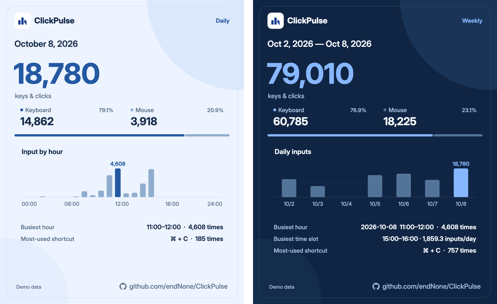
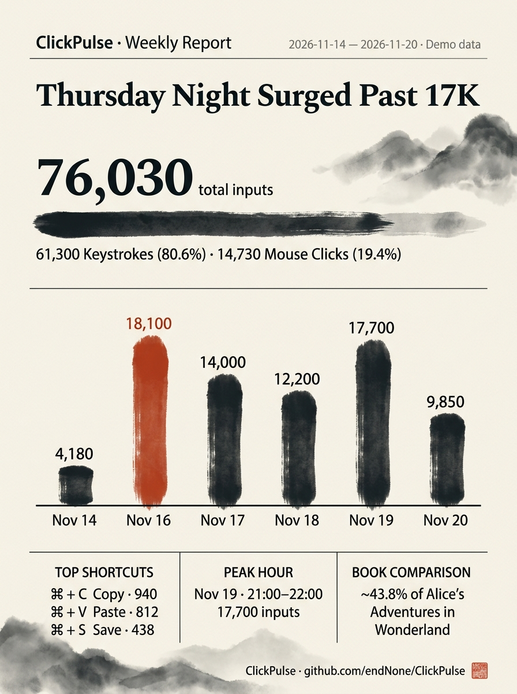
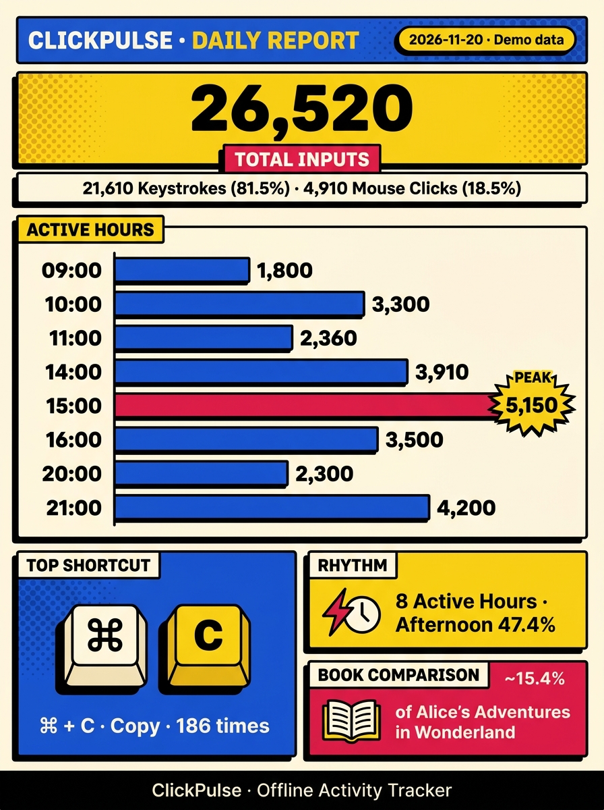
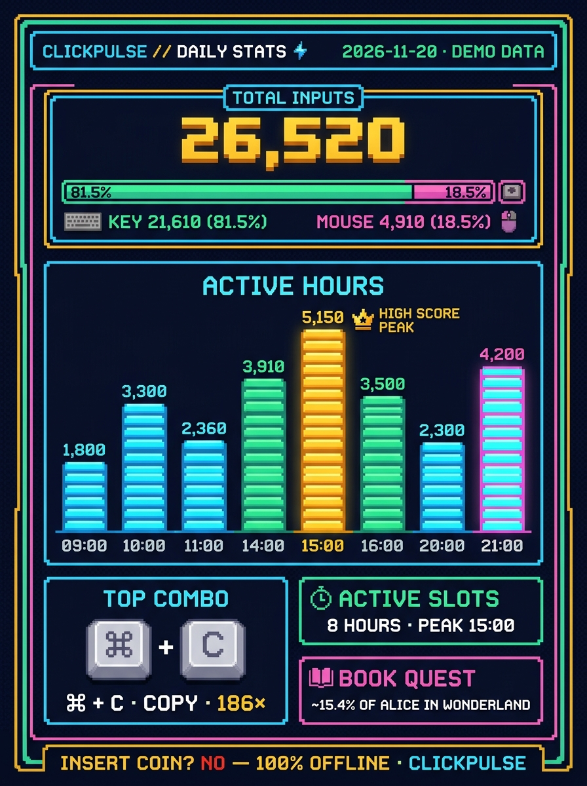
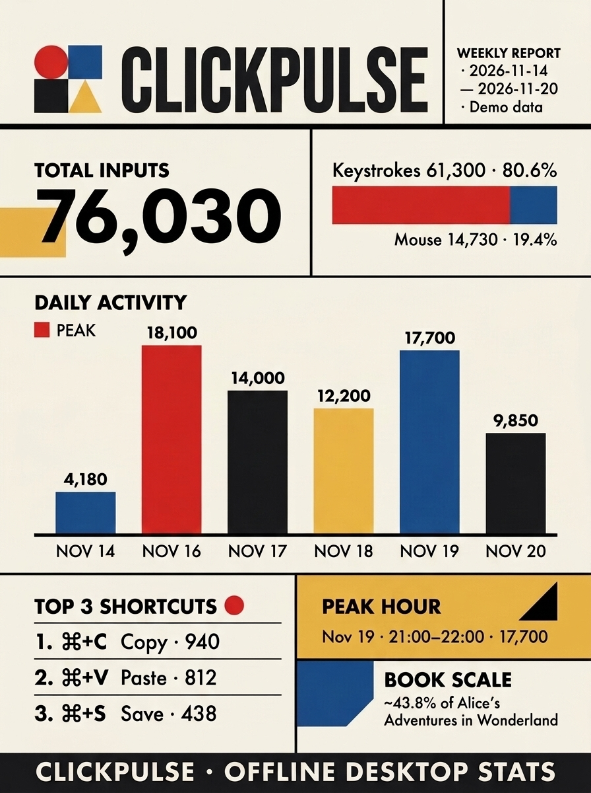
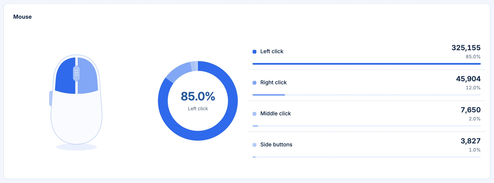
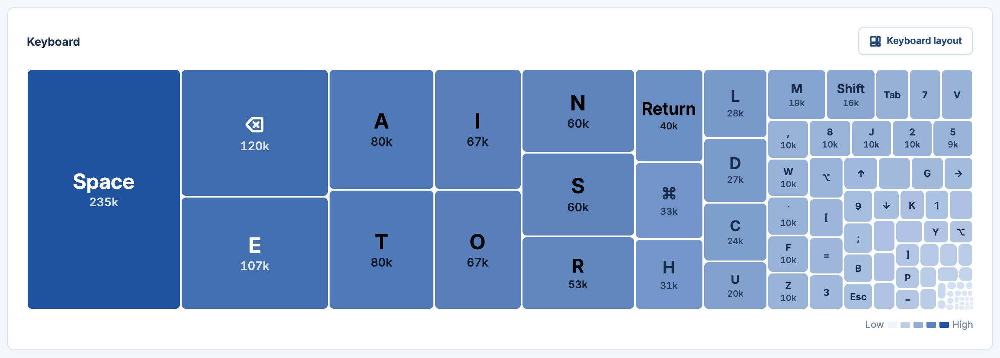
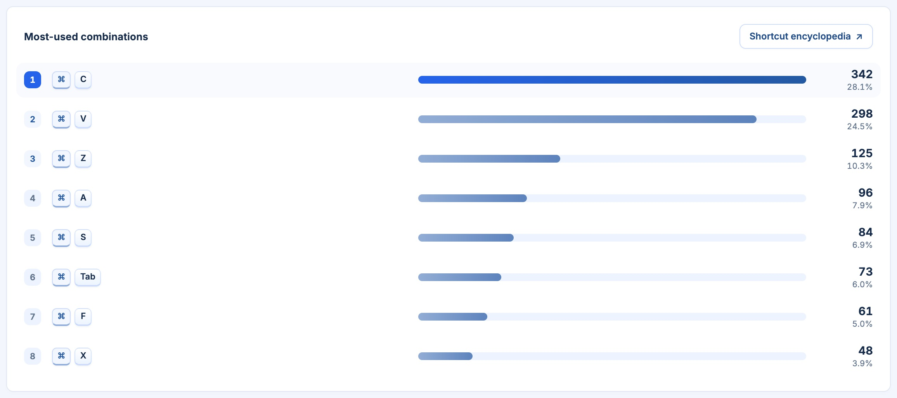

<p align="center"></p>

<h1 align="center">ClickPulse</h1>

<p align="center"><a href="../../README.md">English</a> · <a href="zh-CN.md">简体中文</a> · <strong>繁體中文</strong> · <a href="ja.md">日本語</a> · <a href="ko.md">한국어</a> · <a href="de.md">Deutsch</a> · <a href="es.md">Español</a> · <a href="fr.md">Français</a></p>

<p align="center"><strong>每一次敲擊與點按，都有跡可循。</strong></p>

<p align="center">ClickPulse 是一款離線桌面應用程式，透過每日統計、歷史紀錄與熱度圖，呈現你的鍵盤與滑鼠使用情形。</p>

<p align="center">
  <a href="https://github.com/endNone/ClickPulse/releases/tag/v0.3.2"></a>
  <a href="../development.md"></a>
  <a href="../../LICENSE"></a>
  <br>
  <a href="../install-macos.md"></a>
  <a href="../install-windows.md"></a>
  <a href="../install-linux.md"></a>
</p>

<p align="center"><strong><a href="#安裝">安裝</a></strong> · <a href="https://github.com/endNone/ClickPulse/releases/tag/v0.3.2">下載 v0.3.2</a> · <a href="../development.md">從原始碼建置</a> · <a href="https://endnone.github.io/ClickPulse/">快捷鍵百科</a></p>

<p align="center">按鍵與點擊統計只儲存在你的裝置上，無須帳號，也不收集遙測資料。</p>

## Mini 模式

使用其他應用程式時，也能透過小型浮動視窗查看即時計數。

[](../images/mini-desktop-en.webp)

## Sport 模式

點選 Mini 視窗中的閃電按鈕，即可開啟隨打字與點擊速度變化的動畫效果。

[](../images/sport-desktop-en.gif)

## 總覽

[](../images/overview-en.jpg)

### 每日與每週活動報告

<p align="center"><a href="../images/report-en.png"></a></p>

### AI 海報範例

<p align="center">
  <a href="../images/poster-weekly-ink.webp"></a>
  <a href="../images/poster-daily-pop.webp"></a>
</p>

<p align="center">
  <a href="../images/poster-daily-arcade.webp"></a>
  <a href="../images/poster-weekly-bauhaus.webp"></a>
</p>

## 畫面截圖

### 鍵盤熱度圖

[](../images/keyboard-en.jpg)

### 滑鼠按鍵分布

[](../images/mouse-en.jpg)

### 按鍵使用分布（矩形式樹狀圖）

[](../images/treemap-en.jpg)

### 歷史紀錄

[](../images/history-en.jpg)

### 快速鍵統計

[](../images/shortcuts-en.jpg)

## 安裝

- **macOS 12+** (Apple Silicon / Intel) · [下載 DMG](https://github.com/endNone/ClickPulse/releases/tag/v0.3.2)
- **Windows 10 / 11** (x64) · [下載可攜式 ZIP](https://github.com/endNone/ClickPulse/releases/tag/v0.3.2)
- **Linux** (Ubuntu 22.04 / 24.04) · [下載 Linux 套件](https://github.com/endNone/ClickPulse/releases/tag/v0.3.2)

### 使用 Homebrew 或 Scoop 安裝

**macOS · Homebrew**

```sh
brew tap endnone/clickpulse https://github.com/endNone/ClickPulse
brew install --cask endnone/clickpulse/clickpulse
```

**Windows · Scoop**

```powershell
scoop bucket add clickpulse https://github.com/endNone/ClickPulse
scoop install clickpulse
```

macOS 版未經 Apple 公證，Windows 版未簽署。系統可能會阻擋首次啟動。

各平台安裝指南 · [macOS](../install-macos.md) · [Windows](../install-windows.md) · [Ubuntu](../install-linux.md)

## 下載大小與記憶體用量

v0.3.1 各平台的桌面版下載檔都小於 7.3 MB。在三個測試系統上，背景啟動時的記憶體用量比 v0.3.0 **減少了 88.5%–98.9%**。

**下載大小（MB）**

| 平台 | x64 | ARM64 |
| :--- | ---: | ---: |
| macOS 12+ | 7.27 DMG · 6.56 ZIP | 6.99 DMG · 6.31 ZIP |
| Windows 10/11 | 4.62 ZIP | — |
| Ubuntu 22.04 / 24.04 | 6.53 ZIP | 6.44 ZIP |

**實測記憶體用量（MB）**

| 測試系統 | 背景啟動 | 完整視窗 | Mini 模式 | 隱藏 10 分鐘後 |
| :--- | ---: | ---: | ---: | ---: |
| macOS · Apple Silicon | **16.5** | 234.1 | 165.7 | 31.1 |
| Windows 11 · x64 | **2.4** | 225.0 | 181.4 | 3.7 |
| Ubuntu 24.04 · x64 | **44.5** | 261.8 | 266.6 | 109.3 |

數值包含主程式與介面程序，取五次取樣的中位數。測試時關閉了輸入記錄，完整視窗使用英文介面。macOS 採用 physical footprint，Windows 採用 USS，Ubuntu 採用 PSS 並使用軟體算繪。 [v0.3.1 安裝套件與完整測試數據](https://github.com/endNone/ClickPulse/releases/tag/v0.3.1).

## 授權條款

程式碼採用 [GPL-3.0-or-later](../../LICENSE) 授權。ClickPulse 名稱與圖示不在此授權範圍內，適用依 GPLv3 第 7(c) 與 7(e) 款訂定的[附加條款](../../TRADEMARKS.md)。先前發布的版本沿用發布當時的條款。

## 更多資訊

[專案文件](../README.md) · [更新紀錄](../../CHANGELOG.md)<br>
[回報問題](https://github.com/endNone/ClickPulse/issues/new/choose) · [參與討論](https://github.com/endNone/ClickPulse/discussions)

## GitHub 星號數趨勢

如果 ClickPulse 對你有幫助，歡迎在 GitHub 上給它一顆星 🌟

<p align="center"><a href="https://www.star-history.com/#endNone/ClickPulse&amp;Date"></a></p>

## 致謝

感謝[小众软件社群](https://meta.appinn.net/t/topic/95871/16)和 [LINUX DO](https://linux.do/) 社群的朋友們試用 ClickPulse，分享使用心得與改進建議。
