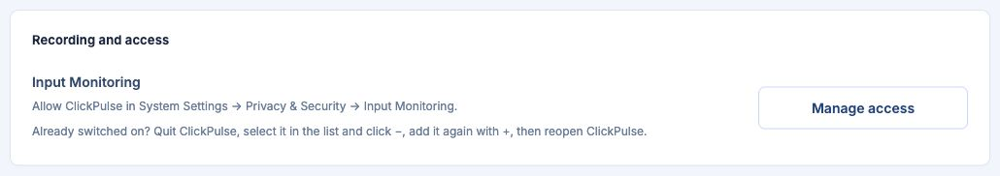

# macOS 安装指南

[English](../install-macos.md) · **简体中文**

## 1. 下载与安装

[下载 DMG 安装包](https://github.com/endNone/ClickPulse/releases/latest)（支持 macOS 12 及以上），或使用 [Homebrew](package-managers.md#macos-homebrew-cask) 安装。

- Apple 芯片（M1 及更新）选择 **arm64**；Intel 芯片选择 **x64**。

1. 打开 DMG 文件，将 **ClickPulse** 拖入 **应用程序（Applications）** 文件夹。
2. 从「应用程序」中打开 ClickPulse。

## 2. 首次启动授权

从 **0.3.2** 起，公开发布的 macOS 版本使用项目固定的自签名证书，但未经 Apple 公证。如果系统阻止首次打开：

1. 打开 **系统设置 → 隐私与安全性**。
2. 在 ClickPulse 旁点击 **仍要打开**，输入密码验证后选择 **打开**。

截图来源：Apple。

## 3. 开启输入监控权限

1. 在软件中打开 **设置 → 记录与权限 → 管理权限**。
2. 在 **输入监控（Input Monitoring）** 中勾选 **ClickPulse**，然后完全退出并重新打开软件。
3. 确认状态显示为 **记录中**，且敲击键盘或点击鼠标时计数正常增加。

## 常见问题

使用 macOS 12（Monterey）？

首次打开请前往 **系统偏好设置 → 安全性与隐私 → 通用 → 仍要打开**。

输入监控权限请前往 **隐私 → 输入监控**，点击左下角解锁后勾选 ClickPulse。

提示“已损坏”或“将对你的电脑造成伤害”？

请重新下载安装包。如果问题仍然存在，欢迎[提交 Issue](https://github.com/endNone/ClickPulse/issues/new/choose)，或参考 [Apple 官方说明](https://support.apple.com/en-us/102445)。

**从 0.3.1 或更早版本升级？** 0.3.2 起签名身份已切换为固定证书，升级后需要重新授权一次输入监控；后续使用同一证书发布的版本将自动保留该权限。

**如何重新授权：** 先退出 ClickPulse；在「输入监控」列表中选中旧条目点击 **−** 移除，再点击 **+** 重新添加更新后的 App 并勾选，最后重新打开软件。

**如何更新？** 打开 **设置 → 应用 → 检查更新**，下载完成后点击 **更新并重启**（可在设置中关闭每日自动检查）。0.2.0 及更早版本需手动下载更新一次。

**历史数据存在哪？** 默认位于 `~/Library/Application Support/ClickPulse`（除非你更改了保存目录）。更新或删除程序本身不会清除历史数据。
