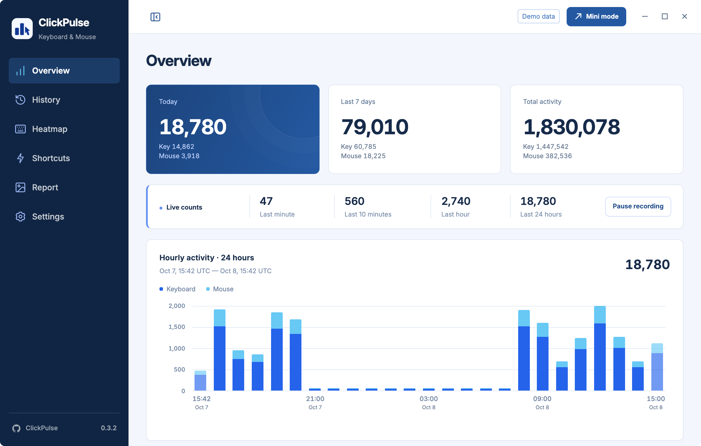
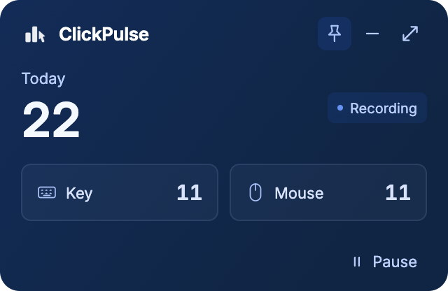

# Windows 安装指南

[English](../install-windows.md) · **简体中文**

## 1. 下载与安装

[下载便携版 ZIP](https://github.com/endNone/ClickPulse/releases/latest)（支持 Windows 10/11 x64），或使用 [Scoop](package-managers.md#windows-scoop) 安装。

1. 将整个压缩包解压到固定目录（例如 `%LOCALAPPDATA%\Programs\ClickPulse`）。
2. 双击目录中的 **ClickPulse.exe** 启动。

## 2. 首次启动

ClickPulse 尚未进行商业代码签名。如果弹出 **Microsoft Defender SmartScreen** 提示，点击 **更多信息 → 仍要运行** 即可。遇到其他安全拦截请看下方[安全提示说明](#windows-security-prompts)。

## 3. 开始记录

Windows 无需额外授予键鼠权限。启动后确认状态显示为 **记录中**，随后按键或点击鼠标即可看到计数增加。

## 常见问题

**提示缺少 WebView2？** 请先安装 [Microsoft Edge WebView2 Runtime](https://developer.microsoft.com/microsoft-edge/webview2/#download-section)，再重新打开 ClickPulse。

遇到智能应用控制（Smart App Control）或错误 4551？

Windows 智能应用控制可能会阻止未签名程序，且不支持为单个应用添加例外。如果是公司受管电脑，请联系管理员；详情可参考 [Microsoft 官方说明](https://support.microsoft.com/en-us/windows/security/threat-malware-protection/smart-app-control-frequently-asked-questions)。

**如何更新？** 打开 **设置 → 应用 → 检查更新**，后台下载完成后点击 **更新并重启**（可在设置中关闭每日自动检查）。Scoop 与 WinGet 安装版会在设置中提示对应的命令行更新指令。

**关闭窗口后为何仍在后台运行？** 可在 **设置 → 关闭行为** 中选择最小化到托盘或直接退出；在系统托盘图标右键选择 **退出 ClickPulse** 可随时保存并退出。

**历史数据存在哪？** 默认位于 `%LOCALAPPDATA%\ClickPulse`（除非更改了保存目录）。更新不会影响历史记录。

## 卸载

打开 **设置 → 应用 → 卸载与数据**，ClickPulse 会在保存并退出前提供两种选择：

- **保留数据**：保留历史记录与偏好设置，仅清理缓存、下载临时文件与日志。
- **删除本地数据**：二次确认后彻底删除本地历史、设置、日志与缓存。

存放在默认目录之外的自定义数据库不会被删除。便携版会自动清理程序文件，Scoop 和 WinGet 版会在选择数据保留策略后提示对应的卸载命令。也可在命令行运行 `ClickPulse.exe uninstall`。
